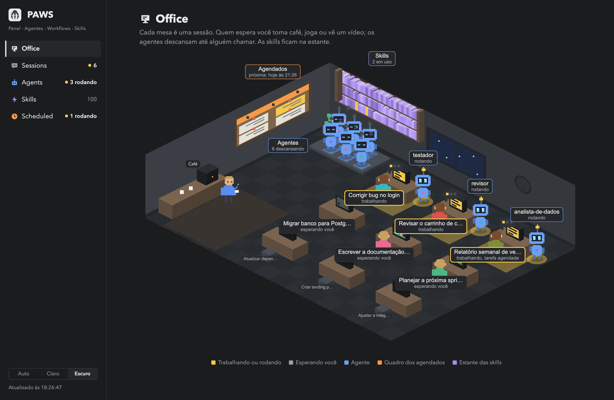
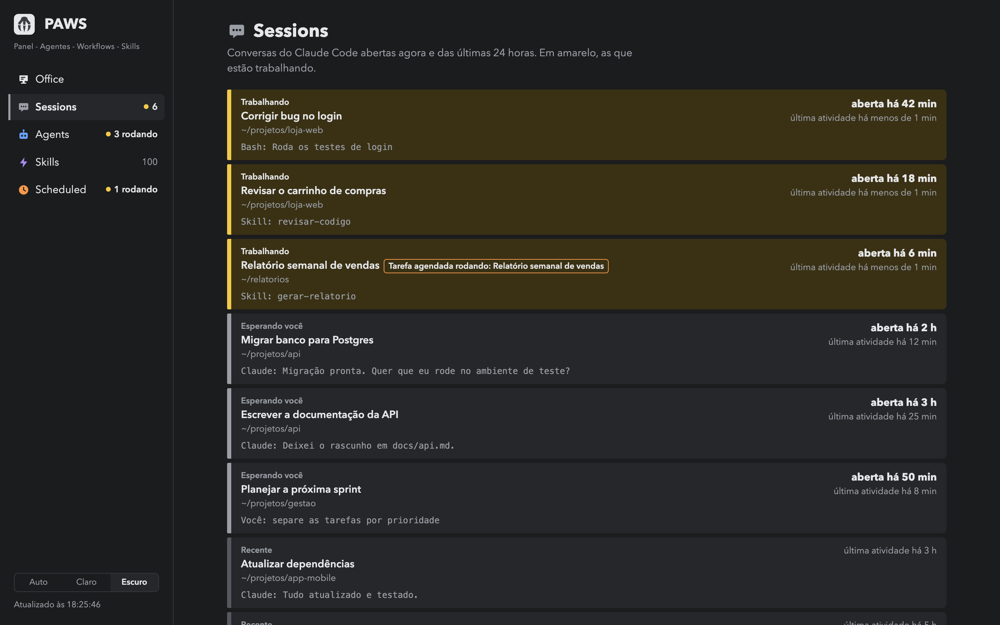
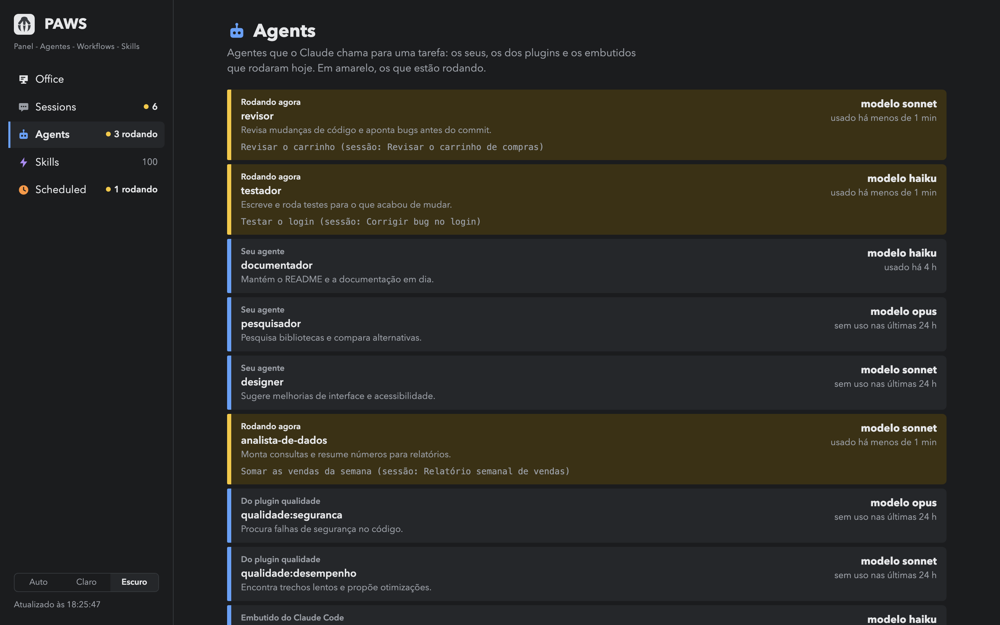
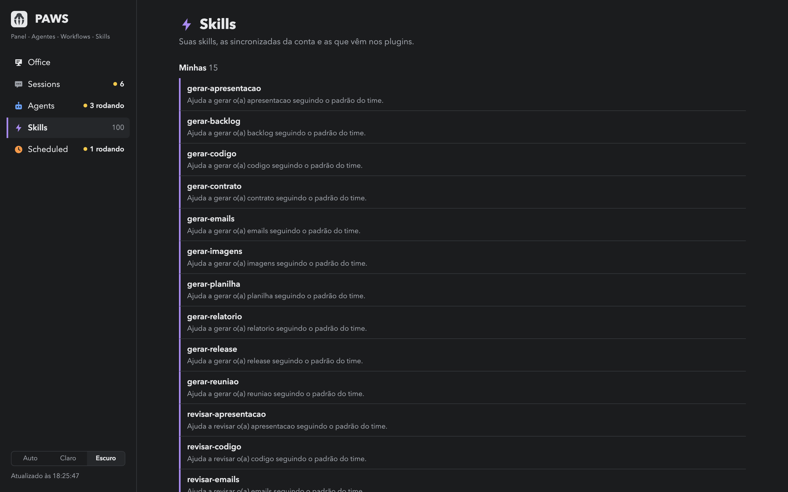
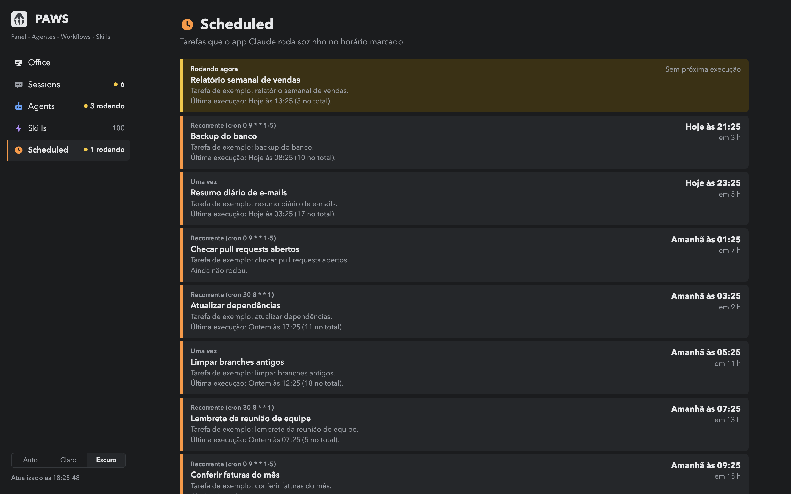
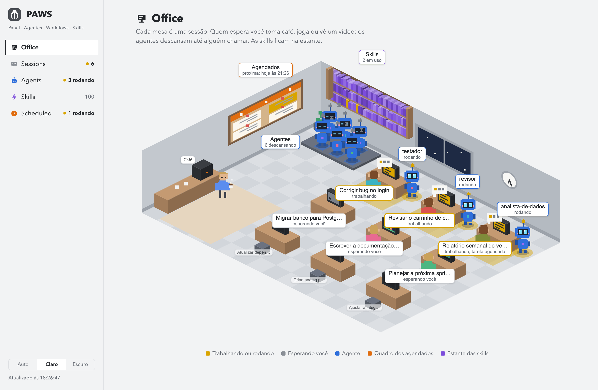

# PAWS

**Panel - Agentes - Workflows - Skills.** Um painel local, só de leitura, para ver no navegador o que o Claude Code está fazendo no seu computador. Funciona no macOS, no Windows e no Linux, e atualiza sozinho a cada 5 segundos.



| Sessões | Agentes |
|---|---|
|  |  |
| **Skills** | **Agendados** |
|  |  |

<details><summary>Tema claro</summary>



</details>

As imagens usam dados de exemplo (veja "Ver com dados de exemplo" abaixo).

- **Escritório:** uma sala em pixel art. Cada mesa é uma sessão: quem está trabalhando fica na mesa com a tela amarela, e quem está esperando você vai tomar café. Os agentes descansam na estação de recarga e andam até a mesa de quem os chamou. O mural laranja mostra as tarefas agendadas (passe o mouse para ver a lista).
- **Sessões:** conversas do Claude Code abertas agora e das últimas 24 horas, com pasta, tempo e o último comando ou mensagem. Em amarelo, as que estão trabalhando.
- **Agentes:** os seus (`~/.claude/agents`), os dos plugins e os embutidos que rodaram hoje. Em amarelo, os que estão rodando.
- **Agendados:** as tarefas agendadas do app Claude, com a próxima e a última execução.
- **Skills:** as suas, as sincronizadas da conta e as que vêm nos plugins.

Tem tema claro e escuro (Auto, Claro ou Escuro, no rodapé do menu).

## Instalar como plugin do Claude Code

No Claude Code, digite:

```
/plugin install paws --marketplace ppdrada/paws
```

Em versões mais antigas do Claude Code, use dois passos:

```
/plugin marketplace add ppdrada/paws
/plugin install paws@paws
```

Pronto: toda vez que o Claude Code abre, o plugin liga o PAWS em segundo plano (se ainda não estiver rodando). É só abrir http://paws.localhost:4777/#office no navegador. O painel continua rodando mesmo depois que você fecha o Claude Code.

Também dá para digitar **`/paws`**: o Claude confere se está ligado e abre o painel no navegador. Para desligar, peça "pare o PAWS".

Precisa do Node 18 ou mais novo ([nodejs.org](https://nodejs.org), versão LTS).

## Rodar sem o plugin

```bash
git clone https://github.com/ppdrada/paws.git
node paws/server.js
```

Depois abra http://paws.localhost:4777/#office (se o seu navegador não abrir esse endereço, use http://localhost:4777/#office).

As abas têm endereço próprio: `#office`, `#sessions`, `#agents`, `#scheduled` e `#skills`.

- Outra porta: `PORT=5000 node paws/server.js` (no PowerShell do Windows: `$env:PORT=5000; node paws\server.js`).
- Se você usa `CLAUDE_CONFIG_DIR`, o PAWS lê essa pasta no lugar de `~/.claude`.

## Ver com dados de exemplo

Para conhecer o painel sem ler nada do seu computador (10 agentes, 100 skills, 20 agendados e algumas sessões inventadas):

```bash
PAWS_DEMO=1 PORT=4790 node paws/server.js
```

Depois abra http://localhost:4790/#office. No PowerShell do Windows: `$env:PAWS_DEMO=1; $env:PORT=4790; node paws\server.js`.

## Onde o PAWS procura os dados

| | Sessões, agentes e skills | Agendados (app Claude para desktop) |
|---|---|---|
| macOS | `~/.claude` | `~/Library/Application Support/Claude` |
| Windows | `%USERPROFILE%\.claude` | `%APPDATA%\Claude` |
| Linux | `~/.claude` | `~/.config/Claude` |

Sem o app Claude para desktop, a seção Agendados mostra só os nomes das tarefas.

## Teste

```bash
node paws/test.js
```

## Ligar sozinho no login (opcional, macOS)

Crie `~/Library/LaunchAgents/com.paws.server.plist` trocando os dois caminhos (veja o do Node com `which node`):

```xml
<?xml version="1.0" encoding="UTF-8"?>
<!DOCTYPE plist PUBLIC "-//Apple//DTD PLIST 1.0//EN" "http://www.apple.com/DTDs/PropertyList-1.0.dtd">
<plist version="1.0">
<dict>
  <key>Label</key><string>com.paws.server</string>
  <key>ProgramArguments</key>
  <array>
    <string>/CAMINHO/DO/node</string>
    <string>/CAMINHO/DO/paws/server.js</string>
  </array>
  <key>RunAtLoad</key><true/>
  <key>KeepAlive</key><true/>
</dict>
</plist>
```

Para ligar e desligar:

```bash
launchctl bootstrap gui/$(id -u) ~/Library/LaunchAgents/com.paws.server.plist
launchctl bootout gui/$(id -u)/com.paws.server
```

## Privacidade e limites

- Escuta só em `127.0.0.1` e recusa pedidos que não venham de `localhost`.
- Só lê: não altera nada em `~/.claude`.
- Nunca abre arquivos de credenciais (`.credentials*`, `auth.json`, tokens, `*.key`) nem o `settings.json`.
- Mostra trechos dos seus transcripts (o último comando ou mensagem de cada sessão), só no seu navegador.
- A seção Agendados lê arquivos internos do app Claude que não são documentados. Uma atualização do app pode quebrar essa parte.
